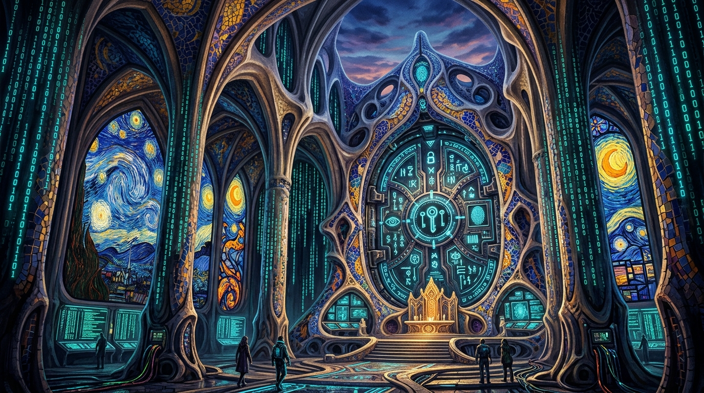

# BIP39-ABOARD-SDK: Documentación (Español) 🛡️✨

> **Motor de incorporación soberana y cifrado en la nube de conocimiento cero (E2EE) para cualquier aplicación.**  
> Reemplazo completo de la autenticación por número de teléfono (SMS) y correo electrónico por claves maestras criptográficas BIP-39.

<p align="center">
  
</p>

---

## 🚀 ¿Por qué reemplazar SMS y Email con BIP-39?

1. **Cero Gastos en SMS:** Elimina los costes recurrentes de Twilio o pasarelas SMS ($0.05–$0.15 por mensaje).
2. **Protección contra SIM-Swap:** Los operadores móviles no pueden transferir su cuenta a atacantes.
3. **Sin Contraseñas en Servidor:** Autenticación criptográfica con firmas EIP-191 Secp256k1.
4. **Cifrado E2EE en la Nube:** Claves simétricas AES-256-GCM derivadas con HKDF-SHA256 para AWS S3, Firebase y Supabase. El proveedor solo almacena datos cifrados ilegibles.
5. **PIN de Pánico:** Borrado de emergencia de memoria física y caché en menos de 10 milisegundos.
6. **Rendimiento con Rust:** Ejecución en WebAssembly 15 veces más rápida con limpieza garantizada de memoria (`ZeroizeOnDrop`).

---

## 📦 Inicio Rápido en React / Vite / Next.js

```bash
npm install @bip39-auth/core
```

```tsx
import { BIP39AuthProvider, useBIP39Auth } from '@bip39-auth/core';

export function Root() {
  return (
    <BIP39AuthProvider
      config={{
        appName: 'MiAppSoberana',
        defaultWordCount: 12,
        allowPanicPin: true,
        allowPdfExport: true
      }}
      onDuressWipe={() => alert('¡Datos borrados por pánico!')}
    >
      <App />
    </BIP39AuthProvider>
  );
}
```

---

## ☁️ Cifrado de Conocimiento Cero para Almacenamiento en la Nube

```typescript
import { mnemonicToSeedHex, deriveCloudStorageKey, encryptForCloud, decryptFromCloudAsText } from '@bip39-auth/core';
import { hex } from '@scure/base';

// 1. Obtener la semilla maestra
const seedBytes = hex.decode(await mnemonicToSeedHex(fraseMnemonic));

// 2. Derivar la clave AES de 256 bits para el servicio en la nube
const cloudKey = deriveCloudStorageKey(seedBytes, 'aws_s3_vault_v1');

// 3. Cifrar datos confidenciales en el cliente antes de subir
const encrypted = await encryptForCloud(JSON.stringify(perfilUsuario), cloudKey, 'aws_s3_vault_v1');

// 4. Subir a la nube (el proveedor solo ve ruido aleatorio):
await api.upload({ ciphertext: encrypted.ciphertextBase64, iv: encrypted.ivBase64 });

// 5. Descifrar en cualquier dispositivo autorizado del usuario:
const perfil = JSON.parse(await decryptFromCloudAsText(encrypted, cloudKey));
```

---

## 🎨 20 Temas Visuales
Incluye 20 temas de diseño inspirados en Cyberpunk, Gaudí, Van Gogh, Matrix, Neón, Obsidiana y más.
Configurables en un clic desde el estudio integrado.
